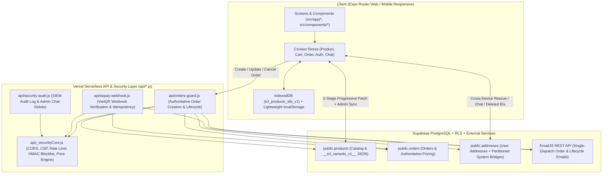

# HANDOFF.md — Tài Liệu Bàn Giao Kỹ Thuật & Trạng Thái Phiên Làm Việc (`tiemcuonlen.shop`)

> **Dự án:** Tiệm Cuộn Len Handmade (`VoHoang07/tiem-cuon-len`)
> **Production Domain:** `https://tiemcuonlen.shop`
> **Cập nhật lần cuối:** Phiên làm việc hiện tại (`commit 9245410` — nhánh `main`)
> **Quy tắc vận hành liên tục:** Sau mỗi đầu việc hoàn thành và vượt qua kiểm thử (`npm run security:check && npm run build:web`), bắt buộc cập nhật file `HANDOFF.md` này và tạo một bản `git commit` gọn gàng cho mốc đó.

---

## 1. Kiến Trúc, Luồng Dữ Liệu & Các Quyết Định Kỹ Thuật Đã Chốt

### 1.1. Tổng quan Kiến trúc Hệ thống (System Architecture)

### 1.2. Luồng Dữ liệu Sản phẩm & Cơ chế Đồng bộ Đa Tầng (`src/store/ProductContext.tsx`)
1. **Tải 2 giai đoạn chống nghẽn mạng di động & vượt ngưỡng Supabase Egress (`fetchProducts` + `hydrateMissingProductMedia`):**
   - **Stage 1 (Metadata-first, `< 10KB`):** Chỉ gọi `SELECT id,name,description,price,category,material,color,quantity,rating,reviews,createdAt` từ `public.products` để hiển thị khung danh mục tức thì.
   - **Stage 2 (Progressive Media Hydration):**
     - **Pass 1:** Tải `select=id,image` theo từng cụm 3 sản phẩm (2 worker song song) cho các sản phẩm chưa có ảnh bìa trong `hydratedMediaMemory`.
     - **Pass 2:** Tải `select=id,tags` (chứa chuỗi JSON `__tcl_variants_v1__:` của `colorOptions`, `accessoryOptions`, `gallery`) theo từng cụm 2 sản phẩm, nghỉ `60ms` giữa các cụm để Garbage Collector trên iOS Safari / Mobile Chrome giải phóng bộ nhớ, chỉ gọi `setProducts` + `saveCachedProducts` **đúng 1 lần** sau khi vòng lặp hoàn tất.
2. **Đồng bộ Chỉnh sửa của Admin Bất khả kháng (`ADMIN_SYNC` Dual-Write):**
   - Khi Admin thêm hoặc sửa sản phẩm (`addProduct` / `updateProduct` $\rightarrow$ `upsertProductToSupabase`), hệ thống ghi đồng thời vào:
     1. Bảng `public.products` (khi có JWT `authenticated` của Admin).
     2. Bảng `public.addresses` với `id = 'tcl_rescue_<product.id>'`, `phone = '__TCL_RESCUE_PROD_V1__'`, và **`ward = 'ADMIN_SYNC'`**.
   - Khi đồng bộ (`syncProducts`, `refetchProducts`) hoặc nạp media (`hydrateMissingProductMedia`), các bản ghi có `ward === 'ADMIN_SYNC'` được ưu tiên cao nhất (`authoritativeAdminSyncMap`), đảm bảo ngay cả khi Admin đăng nhập bằng Google OAuth fallback (không có phiên JWT Supabase) thì mọi thay đổi về giá bán, chất liệu (`Len Nhung Gấu`), phân loại màu vẫn được lưu vĩnh viễn và đồng bộ tức thì sang mọi thiết bị khách hàng.
3. **Đồng bộ Xoá Sản phẩm Vĩnh viễn (`deletedIdsMemory`):**
   - Lưu đồng bộ ở 4 tầng: `Memory Set` $\rightarrow$ `localStorage` (`tcl_deleted_product_ids_v1`) $\rightarrow$ `IndexedDB` (`deleted_product_ids`) $\rightarrow$ `public.addresses` (`id = 'tcl_deleted_products_v1'`).

### 1.3. Luồng Tính Giá Đơn Hàng Chuẩn Xác Trên Server (`api/_securityCore.js` & `api/orders-guard.js`)
- **Tuyệt đối không tin `price` hoặc `total` từ Client gửi lên.**
- Hàm `resolveAuthoritativeProductPrices(baseIds)` trong `api/_securityCore.js` truy vấn song song cả `public.products` và `public.addresses` (`id=in.(tcl_rescue_...)&ward=eq.ADMIN_SYNC`) để lấy bảng giá mới nhất do Admin cập nhật.
- Hàm `computeServerAuthoritativePricing` tính toán lại 100% trên Server:
  - Giá biến thể (`colorOptions[].price`) hoặc giá gốc sản phẩm.
  - Giá trị gói Combo 2 mẫu tự chọn (`calculateSmartCombo2PriceServer`) hoặc 6 bộ Combo chủ đề (`CURATED_COMBO_SPECS_SERVER`).
  - Phụ phí đóng gói **Set Quà Tặng Đặc Biệt (`gift_box_letter`: `+25.000₫`)**.
  - Mã giảm giá (`CHAOBAN10K`, `KHAITRUONG20K`, `TRIAN15K`) và ngưỡng **Freeship đơn từ `>= 299.000₫`** (phí ship tiêu chuẩn `20.000₫`).

### 1.4. Các Quyết Định Kỹ Thuật & Nghiệp Vụ Đã Chốt
1. **Bố cục Trang chủ (`src/app/index.tsx`):**
   - Khung **🎁 Combo Tiết Kiệm Được Yêu Thích Nhất** (`ComboShowcaseSection`) đặt **phía trên** 3 thẻ chọn dòng sản phẩm (`Tất cả dòng SP`, `Sản phẩm từ Len`, `Sản phẩm Kẽm nhung`).
   - 3 thẻ chọn dòng sản phẩm nằm ngay sát phía trên `catalogToolbar` + lưới sản phẩm; giữ `showHeroAndFeatured = !search` để không làm sập Hero Banner gây nhảy vị trí cuộn khi chuyển tab, kết hợp cuộn mượt tới `catalog-filter-anchor` (`scrollToCatalogSection`).
   - Hàm `isVelvetWireProduct(p)` ưu tiên kiểm tra từ khoá `'len'` trong `name` và `material` trước `category`, đảm bảo sản phẩm *"Bó Hoa Hồng Bông Len Nhung Đũa"* (`category: 'VelvetFlowers'`) thuộc dòng **Sản phẩm từ Len**.
2. **Chuẩn hoá Chất liệu Sản phẩm:**
   - Toàn bộ các sản phẩm móc khoá/thú bông từng ghi `Len Cotton Milk` (như *Móc Khoá Zịtt* `user_1793809415860`, *Móc khoá Bé Ma Treo Gió* `user_1793955545289`) và chất liệu mặc định trong `ProductStudioForm.tsx` / `comboCatalog.ts` đã được thống nhất sang **`Len Nhung Gấu`** để đồng bộ bảng màu nguyên liệu thực tế của tiệm.
3. **Thông báo Email Đơn hàng (`api/_securityCore.js`):**
   - Đơn COD bắn email ngay khi tạo đơn trên Server; đơn QR SePay (`pending_payment`) chỉ bắn email sau khi Webhook SePay xác nhận tiền vào tài khoản thành công.
   - Mỗi đơn chỉ gửi **đúng 1 request EmailJS duy nhất** kèm khoá chống trùng kép (`notifiedOrderIdsCache` + `shippingAddress.emailNotifiedAt`).

---

## 2. Danh Sách Từng File Đã Tạo Hoặc Sửa Kèm Vai Trò Cụ Thể

| File | Trạng thái | Vai trò & Thay đổi cụ thể |
| :--- | :---: | :--- |
| `src/store/ProductContext.tsx` | Đã sửa | Quản lý toàn bộ vòng đời sản phẩm, cache `IndexedDB`, đồng bộ 2 chiều với Supabase (`public.products` + cầu nối `tcl_rescue_<id>` có cờ `ward: 'ADMIN_SYNC'`). Giữ nguyên dữ liệu Admin đã sửa trong cả `syncProducts`, `refetchProducts` và `hydrateMissingProductMedia`. |
| `src/app/index.tsx` | Đã sửa | Trang chủ cửa hàng: Đưa `ComboShowcaseSection` lên trên 3 nút chọn dòng sản phẩm; giữ ổn định `showHeroAndFeatured = !search`; thêm `scrollToCatalogSection` (`catalog-filter-anchor`); sửa `isVelvetWireProduct` và bộ lọc `CategoryChips` để phân loại chính xác sản phẩm Len vs Kẽm nhung. |
| `api/_securityCore.js` | Đã sửa | Lõi bảo mật & tính giá Server: Cập nhật `resolveAuthoritativeProductPrices` đọc song song `public.products` và `public.addresses` (`ward=eq.ADMIN_SYNC`) để luôn lấy đúng giá Admin vừa sửa khi khách tạo đơn. |
| `api/security-audit.js` | Đã sửa | API SIEM & Quản trị bảo mật: Sửa nhánh `action === 'delete_chat'` gọi đúng `verifySupabaseUser(req)` và kiểm tra `adminUser.isAdmin` thay vì hàm không tồn tại. |
| `src/data/comboCatalog.ts` | Đã sửa | Định nghĩa 6 bộ Combo chủ đề: Chuẩn hoá trường `material` từ `Len Cotton Milk` sang `Len Nhung Gấu` / `Len Nhung Đũa` / `Len Lông Thỏ`. |
| `src/components/ProductStudioForm.tsx` | Đã sửa | Studio thêm/sửa sản phẩm của Admin: Đặt chất liệu mặc định là `Len Nhung Gấu`, hỗ trợ nhập giá riêng cho từng phân loại, bảng 34 màu thu gọn, tự động nén ảnh chuẩn Studio 1440×1440. |
| `src/utils/generateProductDescription.ts` | Đã sửa | Trình tạo mô tả sản phẩm tự động: Đổi chất liệu mặc định sang `Len Nhung Gấu cao cấp`. |
| `src/app/help.tsx` | Đã sửa | Trung tâm trợ giúp & chính sách bảo hành: Cập nhật cam kết chất liệu `Len Nhung Gấu, Len Nhung Đũa & Kẽm nhung loại 1`. |
| `src/components/BoutiqueFooter.tsx` | Đã sửa | Footer toàn trang: Hiển thị cam kết Bảo hành & Đổi trả miễn phí 7 ngày (đổi mới/hoàn tiền 100% nếu bung mối len hoặc gãy móp do vận chuyển). |
| `src/app/product/[id].tsx` | Đã sửa | Trang chi tiết sản phẩm: Hiển thị khung chọn phân loại, khung ghép đôi `ComboStudioLiveView`, chọn bao bì (`Tự dùng` vs `Set Quà Tặng Đặc Biệt +25k`), và hộp cam kết bảo hành 7 ngày. |
| `src/app/cart.tsx` | Đã sửa | Trang giỏ hàng: Sửa lỗi hiển thị `Phí vận chuyển: 0₫` và `Tổng cộng: 0₫` do truy cập nhầm thuộc tính `shippingConfig` cũ (`freeShippingEnabled` / `standardShippingFee` = `undefined` gây `NaN`), đồng bộ sang chuẩn `shippingConfig.freeshipEnabled`, `shippingConfig.freeshipThreshold` và `shippingConfig.hcmFee`. |
| `src/app/checkout.tsx` | Đã sửa | Trang thanh toán: Đồng bộ giá biến thể + phụ phí hộp quà + xem trước thiệp Vintage Airmail + huy hiệu tài khoản xác thực + cam kết đổi trả 100%. |
| `AGENTS.md` & `CLAUDE.md` | Đã sửa | Hiến pháp kỹ thuật & Bộ nhớ tự học (`SELF-EVOLVING MEMORY` từ mục #1 đến #25) luôn được giữ đồng bộ tuyệt đối. |
| `HANDOFF.md` | Mới tạo | Tài liệu bàn giao kiến trúc, trạng thái phiên làm việc, các ràng buộc ngầm và checklist bước tiếp theo. |

---

## 3. Các Trường Hợp Biên (Edge Cases), Ràng Buộc Ngầm & Những Hướng Đã Thử Nhưng Lỗi Cần Tránh

### 3.1. Ràng buộc ngầm của Hạ tầng & Database (Implicit Constraints)
1. **RLS trên `public.products` vs Google OAuth Fallback:**
   - Chính sách RLS của bảng `public.products` chỉ cho phép `INSERT/UPDATE/DELETE` khi request có JWT `authenticated` của tài khoản Admin trong Supabase Auth.
   - Tuy nhiên, khi Admin đăng nhập nhanh bằng Google OAuth popup (client-side token verification) hoặc khi phiên Supabase hết hạn, `supabase.auth.getSession()` không có `access_token` của Supabase.
   - **Cách xử lý bắt buộc:** Luôn ghi song song bản đầy đủ vào `public.addresses` (`id = 'tcl_rescue_<id>'`, `phone = '__TCL_RESCUE_PROD_V1__'`, `ward = 'ADMIN_SYNC'`) vì phân vùng này cho phép đồng bộ xuyên thiết bị, và cả Client lẫn Server (`api/_securityCore.js`) đều đọc bản ghi `ADMIN_SYNC` này làm nguồn chuẩn.
2. **Giới hạn 5MB của `localStorage` & Giới hạn ~300MB RAM của Mobile WebKit:**
   - Các sản phẩm có nhiều phân loại (như *12 Cung Hoàng Đạo*, *Bé Ma Treo Gió 9 mẫu*, *Donut Khổng Lồ 7 mẫu*) chứa chuỗi ảnh Base64 nặng hàng chục MB trong trường `tags` (`__tcl_variants_v1__`).
   - **Đã thử nhưng lỗi (CẦN TRÁNH):**
     - Lưu nguyên mảng sản phẩm có Base64 vào `localStorage` $\rightarrow$ Văng lỗi `QuotaExceededError`, làm kẹt bản cache cũ trong `localStorage`. Khi tải lại trang, `loadCustomAdminProductsSync()` đọc bản cũ từ `localStorage` đè lên giá mới.
     - Gọi `setProducts()` và `saveCachedProducts()` (`saveToIdb` 25MB) bên trong vòng lặp `for` của `hydrateMissingProductMedia` $\rightarrow$ Gây cấp phát `structuredClone` hàng trăm MB liên tiếp làm sập tab iOS Safari (`"Đã xảy ra sự cố trên trang web này"`).
3. **Cấu trúc cột `camelCase` trong PostgreSQL (`public.products`, `public.orders`, `public.addresses`):**
   - Các cột trong DB dùng tên `"createdAt"`, `"userId"`, `"fullName"`, `"detailAddress"` (có dấu ngoặc kép phân biệt hoa thường). Tuyệt đối không truy vấn `created_at` hay gắn tham số lạ như `&_t=...` vào URL REST của PostgREST (gây lỗi `400 PGRST100`).
4. **Xử lý đối tượng ảnh `require(...)` trên Expo Web:**
   - Các ảnh tĩnh đóng gói qua `require('@/assets/images/...')` trả về object `{ uri: '/assets/...', width, height }`. Khi truyền vào thẻ `React.createElement('img', { src })` trên Web bắt buộc phải đi qua hàm `resolveImageUri(src)` nếu không sẽ bị lỗi `src="[object Object]"`.
5. **Tránh ẩn đột ngột Hero Banner khi lọc trên Trang chủ:**
   - Trước đây đặt `showHeroAndFeatured = !search && selectedCategory === 'All' && selectedMainLine === 'all'` khiến toàn bộ phần đầu trang biến mất ngay khi bấm vào thẻ `"Sản phẩm từ Len"` hoặc `"Sản phẩm Kẽm nhung"`, làm vị trí cuộn của người dùng bị giật tung. Phải giữ `showHeroAndFeatured = !search`.
6. **Chuẩn tên trường `ShippingConfig` (`PaymentMethodsContext.tsx`):**
   - Đối tượng `shippingConfig` chỉ có 4 trường: `freeshipEnabled`, `freeshipThreshold`, `hcmFee`, `provincialFee`. Tuyệt đối không dùng tên cũ (`freeShippingEnabled`, `freeShippingThreshold`, `standardShippingFee`) vì sẽ trả về `undefined`, khiến phép cộng `cartTotal + shippingFee` thành `NaN` và `formatVND(NaN)` hiển thị `0₫`.

---

## 4. Checklist Chi Tiết Các Việc Tiếp Theo Theo Thứ Tự Ưu Tiên

> **Quy trình bắt buộc cho mỗi mục dưới đây:**
> Thực hiện code $\rightarrow$ Chạy `npm run security:check && npm run build:web` Pass 100% $\rightarrow$ Cập nhật trạng thái vào `HANDOFF.md` $\rightarrow$ `git commit` & `git push`.

- [ ] **Ưu tiên 1 — Kiểm tra & Đồng bộ Bộ lọc Chất liệu / Tìm kiếm Nhanh theo dòng Len (`src/app/index.tsx` & `src/components/ProductCard.tsx`):**
  - **File & Hàm cần xử lý:**
    - `src/app/index.tsx` (`filteredProducts`, `isVelvetWireProduct`): Đảm bảo khi khách gõ tìm kiếm theo tên chất liệu (`"nhung gấu"`, `"nhung đũa"`, `"lông thỏ"`, `"kẽm nhung"`) hoặc lọc theo danh mục con đều trả về đúng 100% sản phẩm đã chuẩn hoá chất liệu.
- [ ] **Ưu tiên 2 — Công cụ Thống kê Nguyên liệu & Tồn kho theo Đơn hàng cho Admin (`src/app/manage-products.tsx` hoặc `src/app/orders/index.tsx`):**
  - **File & Hàm cần xử lý:**
    - `src/app/orders/index.tsx` (`AdminOrdersView`): Bổ sung bảng tóm tắt nhanh số lượng từng mẫu/màu đang cần làm trong các đơn `pending` / `processing` để chủ shop nhìn ngay cần móc bao nhiêu bé bằng *Len Nhung Gấu*, *Len Nhung Đũa*, *Len Lông Thỏ* mà không phải đếm thủ công từng đơn.
- [ ] **Ưu tiên 3 — Tối ưu Hoá Ảnh Base64 Sang Lưu Trữ Nhẹ & Dọn Dẹp Bản Ghi `tcl_rescue_*` Cũ (`src/store/ProductContext.tsx`):**
  - **File & Hàm cần xử lý:**
    - `src/store/ProductContext.tsx` (`upsertProductToSupabase`, `fetchRemoteRescuedProducts`, `deleteProductFromSupabase`): Khi Admin xoá hoặc gộp sản phẩm, tự động dọn sạch các bản ghi `tcl_rescue_<id>` mồ côi nằm trong danh sách `deletedIdsMemory` để giữ bảng `public.addresses` nhẹ và nhanh.
- [ ] **Ưu tiên 4 — Kiểm toán toàn diện Luồng Thanh toán QR SePay & Voucher Khai Trương (`api/orders-guard.js`, `api/sepay-webhook.js`, `src/app/checkout.tsx`):**
  - **File & Hàm cần xử lý:**
    - `api/orders-guard.js` (`computeServerAuthoritativePricing`) và `src/app/checkout.tsx`: Đảm bảo mọi đơn hàng áp mã giảm giá (`CHAOBAN10K`, `KHAITRUONG20K`, `TRIAN15K`) hoặc chọn `Set Quà Tặng Đặc Biệt (+25.000₫)` đều khớp từng đồng giữa màn hình Checkout, mã VietQR và SePay Webhook.
