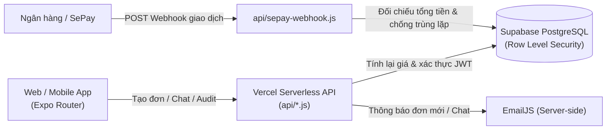

# Tiệm Cuộn Len (`tiemcuonlen.shop`)

Ứng dụng thương mại điện tử đa nền tảng (Web, iOS, Android) dành cho cửa hàng đồ len thủ công **Tiệm Cuộn Len**.

- **Website đang chạy thực tế:** [https://www.tiemcuonlen.shop](https://www.tiemcuonlen.shop)
- **Nền tảng:** Expo SDK 54 (React Native 0.81 + React 19 + TypeScript 5.9), Vercel Serverless API, Supabase (PostgreSQL + Auth + RLS) và Cloudflare Edge.

---

## Tính năng chính

### 1. Cửa hàng & Mua sắm (Khách hàng)
- **Danh mục & Biến thể sản phẩm:** Xem các sản phẩm móc len thủ công theo từng mẫu/màu sắc, ảnh bìa ghép tổng hợp chuẩn `1440×1440` WebP tải trực tiếp qua Vercel CDN.
- **Tự ghép Combo 2 mẫu (`ComboStudioLiveView`):** Khách có thể tự chọn 2 mẫu lẻ bất kỳ trên cùng khung xem trực tiếp với giá ưu đãi theo gói.
- **Đóng gói quà tặng (`VintageGiftCardPreview`):** Tuỳ chọn hộp quà kèm thiệp viết tay xem trước nội dung lời nhắn ngay trên trang sản phẩm và giỏ hàng.
- **Giỏ hàng & Mua ngay:** Đồng bộ giá thực tế từ danh mục mới nhất, tự tính mốc Freeship (`>= 199.000₫`), áp mã giảm giá và lưu bền vững qua `localStorage` / Supabase.
- **Địa chỉ giao hàng 3 cấp:** Hỗ trợ tự động điền Tỉnh/Thành — Quận/Huyện — Phường/Xã từ toạ độ trình duyệt hoặc tra cứu hành chính Việt Nam (`useAutoLocation.ts`).
- **Thanh toán COD & VietQR tự động:** Sinh mã QR chuyển khoản đúng số tiền và nội dung đơn hàng (`CUONLEN-...`). Khi khách chuyển khoản xong, Webhook từ **SePay** tự động đối chiếu số tiền và chuyển trạng thái đơn sang *Đang xử lý* mà không cần duyệt tay.

### 2. Quản trị cửa hàng & CSKH (Admin)
- **Product Studio (`ProductStudioForm.tsx`):** Đăng và chỉnh sửa sản phẩm nhiều phân loại ngay trên trình duyệt, tự động kiểm tra định dạng file gốc (Magic Bytes), căn khung vuông `1440×1440` và lưu nháp vào `IndexedDB` để không mất dữ liệu khi tải nhiều ảnh dung lượng lớn.
- **Quản lý đơn hàng & Vận chuyển:** Cập nhật trạng thái đơn theo từng chặng (*Chờ xác nhận → Đang xử lý → Đang giao → Hoàn thành*), cấu hình phí ship nội thành TP.HCM / liên tỉnh và ngưỡng Freeship trực tiếp trên giao diện.
- **Chat trực tuyến thời gian thực (`ShopChatWidget.tsx`):** Nhắn tin hai chiều giữa khách và chủ tiệm, đính kèm thẻ sản phẩm cần hỏi, đổ chuông thông báo trình duyệt và tự gửi email báo tin nhắn mới khi chủ tiệm hoặc khách đã đóng tab web.
- **Hồ sơ khách truy cập & Trung tâm bảo mật (`/privacy`):**
  - Gom lịch sử hoạt động theo từng khách truy cập thật (sản phẩm đã bấm xem, thời gian đứng xem, mẫu đã bỏ giỏ, bước thanh toán đang dừng lại), tự động lọc bỏ lượt xem thử của Admin.
  - Quản lý danh sách chặn IP đơn lẻ có chữ ký `HMAC-SHA256` và theo dõi cảnh báo Bot / Rate Limit.

---

## Kiến trúc & Bảo mật

Đơn hàng và thanh toán không phụ thuộc vào dữ liệu giá từ phía trình duyệt:



Các lớp bảo vệ đang bật sẵn trong dự án:
- **Tính giá tại Server (`api/orders-guard.js`):** Tổng tiền hàng, phí đóng gói hộp quà, mã giảm giá và phí vận chuyển đều được tính lại trên Server trước khi ghi vào bảng `orders`.
- **Xác thực Webhook SePay (`api/sepay-webhook.js`):** Kiểm tra `SEPAY_WEBHOOK_SECRET`, chỉ nhận giao dịch tiền vào (`transferType === 'in'`) đúng số tài khoản cấu hình, kiểm tra đủ số tiền và chống xử lý lặp (Idempotency) khi SePay gọi lại webhook.
- **Row Level Security (`supabase/migrations/`):** Phân tách quyền đọc/ghi giữa khách hàng (`anon` / `authenticated`) và quản trị viên (`is_shop_admin()`) trực tiếp trong PostgreSQL.
- **Chống Bot, XSS & Mass-Assignment (`api/_securityCore.js`, `vercel.json`):** Áp dụng `Content-Security-Policy`, `Strict-Transport-Security`, kiểm tra `Origin` chống CSRF, giới hạn tần suất gọi API theo cửa sổ trượt (Sliding-Window Rate Limiter), trường bẫy bot ẩn (`HiddenBotField`) và lọc bỏ trường lạ trong JSON đầu vào.
- **Kiểm tra định dạng ảnh tải lên (`src/utils/fileUploadGuard.ts`):** Đối chiếu byte đầu nhị phân (PNG, JPEG, WebP, GIF) và đổi tên sang UUID v4 trước khi xử lý.

---

## Cấu trúc thư mục

```text
tiem-cuon-len/
├── api/
│   ├── _securityCore.js            # Xác thực JWT, tính giá đơn hàng, CSRF/Rate-limit, gửi Email
│   ├── orders-guard.js             # API tạo, cập nhật trạng thái và xoá đơn hàng có kiểm tra quyền
│   ├── security-audit.js           # API nhật ký hành trình khách truy cập, thông báo chat & chặn IP
│   └── sepay-webhook.js            # Webhook nhận biến động số dư ngân hàng từ SePay
├── public/
│   ├── catalog-media/              # Ảnh sản phẩm và phân loại định dạng WebP phục vụ qua CDN
│   ├── sitemap.xml                 # Sitemap phục vụ Google Search Console
│   └── sw-chat-notify.js           # Service Worker hiển thị thông báo tin nhắn mới
├── scripts/
│   └── security-check.js           # Script quét lộ khoá bí mật, kiểm tra header & API sanitizer
├── src/
│   ├── app/                        # Các màn hình định tuyến theo file của Expo Router
│   ├── components/                 # Thành phần giao diện dùng chung (ProductCard, ShopChatWidget...)
│   ├── data/                       # Danh mục sản phẩm tĩnh & cấu hình gói Combo
│   ├── hooks/                      # Custom hooks (tự lấy địa chỉ GPS/IP, debounce, đăng xuất)
│   ├── services/supabase.ts        # Khởi tạo Supabase client phía trình duyệt/ứng dụng
│   ├── store/                      # Quản lý trạng thái (Auth, Product, Cart, Order, Address, Chat)
│   ├── types/                      # Kiểu dữ liệu TypeScript
│   └── utils/                      # Định dạng tiền tệ, tính khuyến mãi, kiểm tra bảo mật & ảnh
├── supabase/migrations/            # Các bản migration tạo bảng, chỉ mục và chính sách RLS
├── CLOUDFLARE_SECURITY_GUIDE.md    # Ghi chú cấu hình DNS, SSL/TLS và WAF trên Cloudflare
└── vercel.json                     # Cấu hình đóng gói Web, rewrite API và HTTP Security Headers
```

---

## Công nghệ sử dụng

| Tầng | Công nghệ |
| :--- | :--- |
| **Giao diện & Ứng dụng** | React Native `0.81`, Expo SDK `54`, Expo Router `v6`, React `19`, TypeScript `5.9` |
| **Lưu trữ phía trình duyệt** | `IndexedDB` (ảnh HD & bản nháp sản phẩm), `localStorage` (giỏ hàng & phiên làm việc) |
| **Backend & Cơ sở dữ liệu** | Vercel Serverless Functions (Node.js), Supabase PostgreSQL, Supabase Auth (Email + Google/Facebook OAuth) |
| **Thanh toán & Tích hợp** | VietQR, SePay Bank Webhook, EmailJS REST API |
| **Hạ tầng mạng & Bảo mật** | Vercel CDN, Cloudflare WAF / DNS / Full (Strict) SSL |

---

## Cài đặt và chạy thử tại máy (Local)

### Yêu cầu môi trường
- **Node.js** `>= 18` và **npm**
- Một project **Supabase** đang hoạt động

### 1. Tải mã nguồn và cài đặt thư viện
```bash
git clone https://github.com/VoHoang07/tiem-cuon-len.git
cd tiem-cuon-len
npm install
```

### 2. Khởi tạo cơ sở dữ liệu Supabase
Mở **SQL Editor** trên Supabase Dashboard và chạy lần lượt:
1. `supabase/migrations/20261106_new_project_all_in_one.sql` (hoặc `schema.sql` kèm `20261104_rls_security_hardening.sql` và `20261105_indexes_and_rls_fix.sql`) để tạo bảng, chỉ mục và bật đầy đủ chính sách RLS.

### 3. Cấu hình biến môi trường
Tạo file `.env` từ `.env.example` cho phần giao diện:
```bash
cp .env.example .env
```

```env
EXPO_PUBLIC_SUPABASE_URL=https://your-project.supabase.co
EXPO_PUBLIC_SUPABASE_ANON_KEY=your-anon-or-publishable-key
```

Khi triển khai lên **Vercel**, khai báo thêm các biến chỉ dùng ở tầng Server (`api/`):
```env
SUPABASE_SERVICE_ROLE_KEY=your-service-role-key
SEPAY_WEBHOOK_SECRET=your-sepay-webhook-secret
TCL_BLOCKLIST_HMAC_SECRET=your-random-hmac-secret
EMAILJS_SERVICE_ID=your-emailjs-service-id
EMAILJS_TEMPLATE_ID=your-emailjs-template-id
EMAILJS_PUBLIC_KEY=your-emailjs-public-key
EMAILJS_PRIVATE_KEY=your-emailjs-private-key
OWNER_NOTIFY_EMAIL=owner@example.com
```

### 4. Khởi chạy và kiểm tra trước khi deploy
```bash
# Chạy môi trường phát triển trên trình duyệt
npm run web

# Mở bằng Expo Go trên điện thoại / máy ảo
npm run ios
npm run android

# Quét bảo mật tự động (kiểm tra lộ secret, HTTP headers, API schema sanitizer)
npm run security:check

# Xuất bản bundle Web tĩnh ra thư mục dist/ giống môi trường Vercel
npm run build:web
```

---

## Giấy phép

Phát hành theo giấy phép [MIT](LICENSE).
